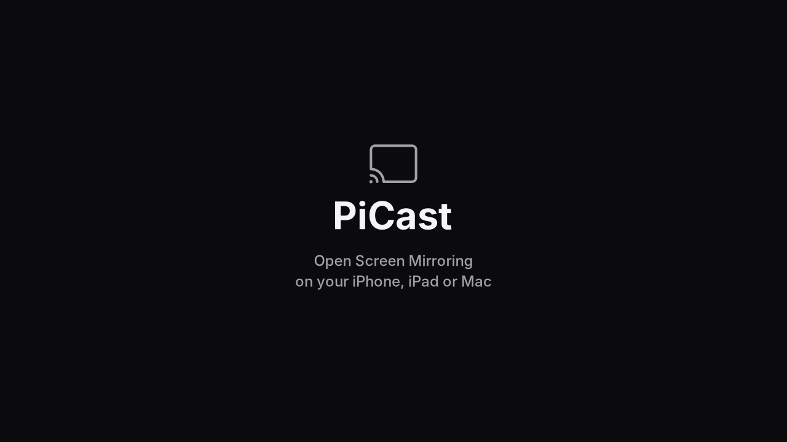
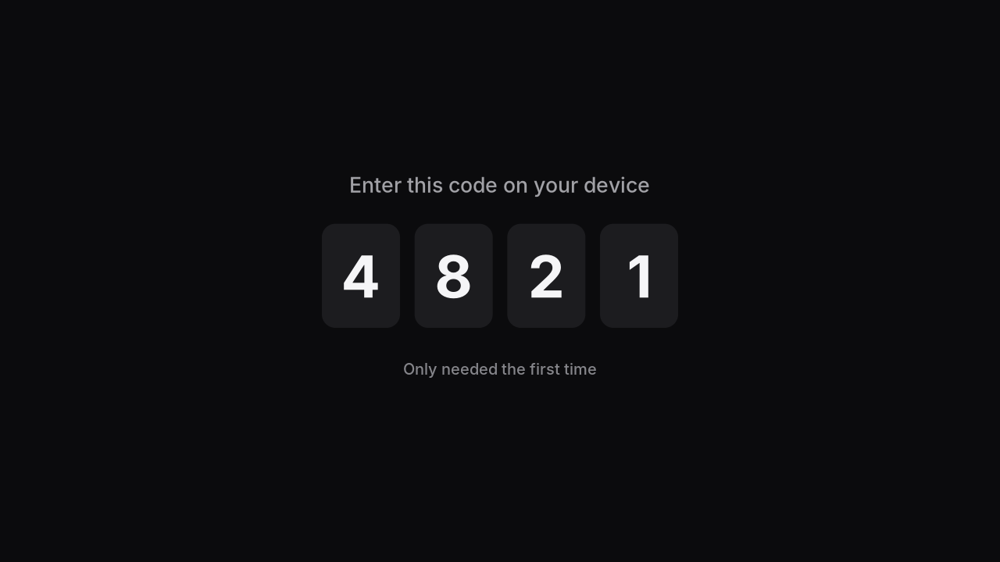

# PiCast

**Mirror your iPhone, iPad or Mac to any TV, with a €20 Raspberry Pi and no Wi-Fi network.**

PiCast turns a Raspberry Pi Zero 2 W into an AirPlay screen mirroring receiver.
Plug it into a TV's HDMI port, switch it on, and it appears in the **Screen
Mirroring** menu of your Apple devices, just like an Apple TV. There is no app
to install, no network to join and no password to type.

<p align="center">
  
  
</p>

## Why PiCast?

There are good AirPlay receivers for Linux already, such as
[UxPlay](https://github.com/FDH2/UxPlay) and RPiPlay. They work over a **Wi-Fi
network**: the Pi and the iPhone must be on the same router. That is fine at
home, but not in a hotel room, a classroom, a car, a holiday flat or on a
customer's projector.

PiCast talks to Apple devices **directly**, over the same peer-to-peer Wi-Fi
(AWDL) an Apple TV uses. That means:

| | PiCast | Network-based receivers |
| --- | --- | --- |
| Needs a Wi-Fi network | **No** | Yes, the same one for both |
| Works anywhere (hotel, school, car, outdoors) | **Yes** | Only with a shared network |
| Setup on the Pi | **None**: flash the card, plug in | Join a Wi-Fi network first |
| Your iPhone keeps its own internet | **Yes** (its Wi-Fi or mobile data) | Yes, if the network has internet |
| Shows up in the iPhone's Screen Mirroring menu | Yes | Yes |
| Hardware | Raspberry Pi Zero 2 W only | Most Raspberry Pis and PCs |

## What you need

- A **Raspberry Pi Zero 2 W** (other models have a different radio chip and do not work)
- A **microSD card**, 8 GB or more
- A **mini-HDMI to HDMI** cable or adapter, and a TV, monitor or projector
- A **micro-USB power supply**, 5 V (2.5 A recommended)
- Optional: a [Waveshare UPS HAT (C)](https://www.waveshare.com/wiki/UPS_HAT_(C)) to run on battery,
  with a battery indicator on screen

## Installation

There are two ways. Both files are on the [Releases page](../../releases/latest).

### Option A: SD card image (recommended)

No Wi-Fi, no computer skills needed.

1. Download **`picast-…img.xz`** from the [latest release](../../releases/latest).
2. Install the [Raspberry Pi Imager](https://www.raspberrypi.com/software/) on your computer and open it.
   - **Device:** Raspberry Pi Zero 2 W
   - **Operating system:** scroll down to **Use custom** and pick the downloaded file
   - **Storage:** your microSD card
   - When it asks about **OS customisation**, choose **No**. (Optional: set a user name,
     password, Wi-Fi and SSH there if you ever want to use [maintenance mode](#maintenance-mode-and-updates).)

   [balenaEtcher](https://etcher.balena.io/) works too: *Flash from file*, pick the card, *Flash*.
3. Put the card into the Pi, connect it to the TV, then plug in the power.

The very first start takes a minute or two longer, and the Pi may restart once
by itself while it sets up the card. After that, PiCast is ready within about a
minute of switching on.

### Option B: installer for an existing Raspberry Pi OS

For people who already have Raspberry Pi OS Lite (64-bit) on a card, or prefer
to set it up themselves. The Pi needs Wi-Fi with internet once, for the installation.

1. With the [Raspberry Pi Imager](https://www.raspberrypi.com/software/), write
   **Raspberry Pi OS Lite (64-bit)** to the card. In the OS customisation, set a user
   name and password, your Wi-Fi with country, and turn on SSH.
2. Download **`picast-install.sh`** from the [latest release](../../releases/latest) and
   copy it onto the card. It shows up on your computer as a drive called **bootfs**.
3. Put the card into the Pi, switch it on, wait a minute, and log in over SSH
   (for example `ssh YOUR-USER@raspberrypi.local`). Then run:

   ```bash
   sudo bash /boot/firmware/picast-install.sh
   ```

   This takes 15 to 30 minutes: the Pi updates its system and builds PiCast.
4. Restart: `sudo reboot`. From now on the Pi is a PiCast receiver. Its Wi-Fi
   connection and SSH are off; the radio belongs to PiCast.

## Using PiCast

1. Switch the Pi on. The TV shows **PiCast – Starting …**. Once it says
   **Open Screen Mirroring on your iPhone, iPad or Mac**, PiCast is ready.
2. **iPhone / iPad:** open Control Center and tap **Screen Mirroring**.
   **Mac:** click Control Center (or the Screen Mirroring icon) in the menu bar.
   After a few seconds **PiCast** appears in the list; select it.
3. The first time after each power-on, the TV shows a **four-digit code**. Type it on
   your device. Until the Pi is switched off, that device connects without the code.

Fullscreen videos with black bars are zoomed automatically so they fill the
screen. Sound plays through the TV.

## Settings

Put the card into a computer and open **`picast.txt`** on the **bootfs** drive
with any text editor. Save, put the card back, switch the Pi on.

```ini
name = PiCast        # the name in the Screen Mirroring list (up to 40 characters)
language = en        # screens in English (en) or German (de)
delay = 270          # picture and sound delay in ms (100-500); raise it if playback stutters
country = DE         # the country you use PiCast in (two letters: DE, AT, CH, GB, US, ...)
maintenance = off    # on: start as a normal Raspberry Pi with Wi-Fi and SSH (see below)
```

## Maintenance mode and updates

In maintenance mode the Pi starts as a normal Raspberry Pi OS, with Wi-Fi and
SSH, and without PiCast. It then installs security updates by itself. (With the
SD card image, this needs the user name, Wi-Fi and SSH set in the Imager's OS
customisation when you wrote the card.)

- **Turn on:** set `maintenance = on` in `picast.txt` on the **bootfs** drive.
- **Turn off:** set it back to `maintenance = off`, or over SSH:
  `sudo sed -i 's/^maintenance *=.*/maintenance = off/' /boot/firmware/picast.txt && sudo reboot`

The kernel is only updated once PiCast has built its radio driver for the new
one, so the radio keeps working.

**New PiCast version:**
- *SD card image:* write the new image to the card. Copy `picast.txt` off the
  card first if you changed settings, and back afterwards.
- *Installer:* in maintenance mode, put the new `picast-install.sh` on the card and run
  `sudo bash /boot/firmware/picast-install.sh` over SSH. Settings are kept.

## Good to know

- PiCast does **screen mirroring**. Sending a video from an app *without*
  mirroring (the AirPlay icon in YouTube and similar) is not supported yet.
- While mirroring, your iPhone shares its radio between PiCast and its Wi-Fi.
  On 2.4 GHz Wi-Fi its internet may be a bit slower; on 5 GHz Wi-Fi or mobile
  data you will hardly notice.
- Picture and sound run about a quarter of a second behind the device, smoothly
  and in sync with each other.
- PiCast uses the resolution the screen starts in and adapts to its shape
  (16:9, 16:10, 21:9, …). The Zero 2 W drives at most about 1920 × 1200 at 60 Hz;
  larger screens (1440p, 4K) get 1080p and scale it themselves.
- One device mirrors at a time. The pairing is forgotten when the Pi is switched off.
- The radio runs a patched firmware. If it ever hangs, PiCast restarts it, and
  if that fails, the Pi restarts.

## Troubleshooting

| Problem | What to do |
| --- | --- |
| PiCast does not show up in the list | Wait until the TV shows "Open Screen Mirroring…". Close the list and open it again. Bring the device closer to the Pi. Check that `country` in `picast.txt` is two letters. |
| The connection drops right after the code | Try again; the second attempt usually works. |
| The picture stutters | Move closer; avoid walls or metal between the device and the Pi. Try `delay = 350` in `picast.txt`. |
| Picture stretched or wrong resolution | The **bootfs** drive has a file `picast-display.txt` with what your screen reports. Please attach it to a [GitHub issue](../../issues). |
| The installer stops with an error | Its log is in `/var/log/picast-setup.log`. You can simply run the installer again. |
| Nothing at all on the TV | Check the power supply (2.5 A) and the mini-HDMI connection; the green LED on the Pi should light up or flicker while it starts. |

Bugs and ideas are welcome as [GitHub issues](../../issues).

## More

- [How PiCast works](docs/HOW_IT_WORKS.md): the radio link, AirPlay and video output
- [Building and developing](docs/BUILDING.md): build from source, tests, releases
- [Radio firmware and driver](radio/README.md): what is patched and why
- [Third-party components and licenses](third_party/README.md)

## License and legal

PiCast is free software under the [GNU General Public License v3.0](LICENSE).
It includes [PlayFair](third_party/playfair) and builds on
[Nexmon](https://github.com/seemoo-lab/nexmon); see
[third_party/README.md](third_party/README.md).

PiCast is an independent project. It is not affiliated with, endorsed by or
sponsored by Apple Inc. or Raspberry Pi Ltd. AirPlay, iPhone, iPad and Mac are
trademarks of Apple Inc.; Raspberry Pi is a trademark of Raspberry Pi Ltd.
